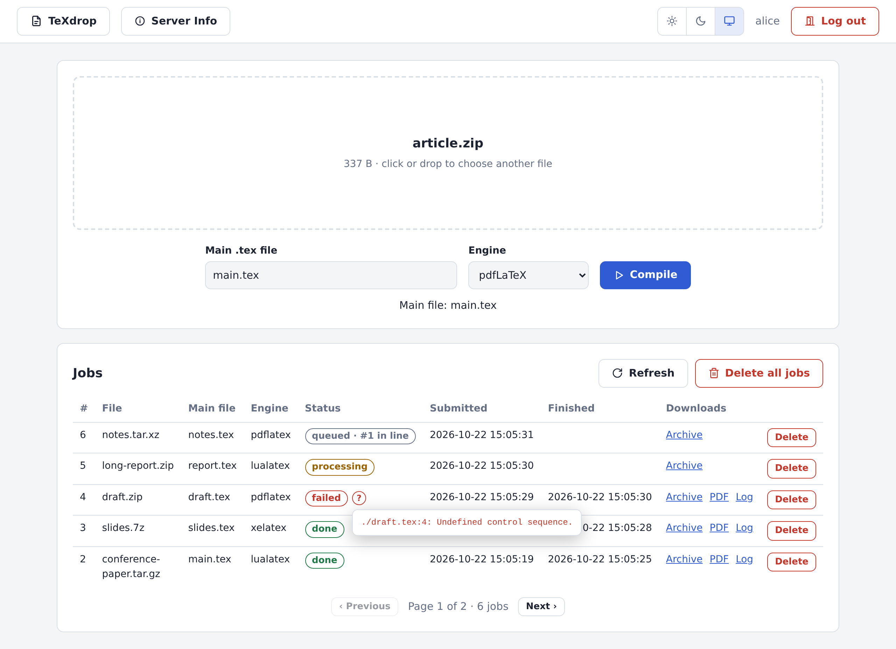

# TeXdrop

A small web service that compiles LaTeX projects. Upload a `.zip`, `.7z`, `.tar`,
`.tar.gz`, `.tar.bz2` or `.tar.xz` archive of a project (with its BibTeX/biblatex
bibliography) and get back the PDF and the compilation log. It is meant to be used
through its HTTP API, and also has a simple web page.



- **Full TeX Live** (every package, as on Overleaf), compiled with `latexmk` using
  pdfLaTeX (default), XeLaTeX or LuaLaTeX; BibTeX or Biber run automatically. Like
  Overleaf, Ghostscript is there (EPS figures) and Java is not.
- **Main file detection**: the only `.tex` file at the top of the project, or the only
  one there with a `\documentclass`. Otherwise you name it.
- **Queue**: jobs from all users run one at a time, strictly in submission order. The
  web server stays responsive during compilations.
- **Per-user tokens and storage**, a job list with status and queue position, downloads
  of the original archive, PDF and log, and deletion of one or all jobs.
- **Sandboxed compilation**: documents cannot read other users' files or the tokens, and
  cannot use the network.

## Running it

```bash
docker build -t texdrop .                    # ~9 GB: the full TeX Live distribution

mkdir data
openssl rand -hex 32                         # run once per user to make a token
cat > data/config.json <<'EOF'
{"users": {"alice": "<token for alice>", "bob": "<token for bob>"}}
EOF
sudo chown -R 1001:1001 data                 # the container runs as uid 1001

docker run -d --name texdrop -p 8000:8000 -v "$PWD/data:/data" \
  -e TZ=Europe/Athens -e AUTO_DELETE_DAYS=15 \
  --cap-drop ALL --security-opt no-new-privileges --restart unless-stopped \
  texdrop
```

or `docker compose up -d` with [`compose.yaml`](compose.yaml). Then open
`http://localhost:8000` and log in with your token. Everything the service stores lives in
the mounted directory, so the container can be removed or upgraded without losing data.
The service also runs without Docker. For the full sandbox it needs Linux 6.12 or newer.

## Using it

**Web page**: drop an archive on the page. The detected main file is filled in, or you
pick one of the archive's `.tex` files; then choose the engine and press **Compile**. The
job list below shows each job's status (point at the **?** of a failed job to see its
errors) and links to its PDF and log. **Server Info** shows
the server's settings and limits. The buttons in the header choose a light or dark theme,
or follow the browser's (Auto); the choice is remembered in the browser.

**API**: send the token as `Authorization: Bearer <token>`.

```bash
curl -H "Authorization: Bearer $TOKEN" -F file=@paper.zip http://localhost:8000/api/jobs
# {"id":42,"status":"queued","queue_position":1,...}
curl -H "Authorization: Bearer $TOKEN" "http://localhost:8000/api/jobs/42?wait=600"   # waits until it is done
curl -H "Authorization: Bearer $TOKEN" -o paper.pdf http://localhost:8000/api/jobs/42/pdf
```

The **[API documentation](docs/API.md)** describes every endpoint with its parameters,
responses and errors, how jobs behave, and has complete examples for building a client.

## Documentation

- [Deployment](docs/DEPLOYMENT.md): requirements, building, running with or without Docker,
  the data directory, container limits, logs.
- [Configuration](docs/CONFIGURATION.md): the users file, the environment variables and their
  defaults, fixed limits.
- [API documentation](docs/API.md): every endpoint, its parameters, responses and errors,
  how jobs behave, and examples in the shell and Python.
- [Security](docs/SECURITY.md): the sandbox and the other protections, and older kernels.
- [Development](docs/DEVELOPMENT.md): how it works, and the tests.

## License

[MIT](LICENSE)
