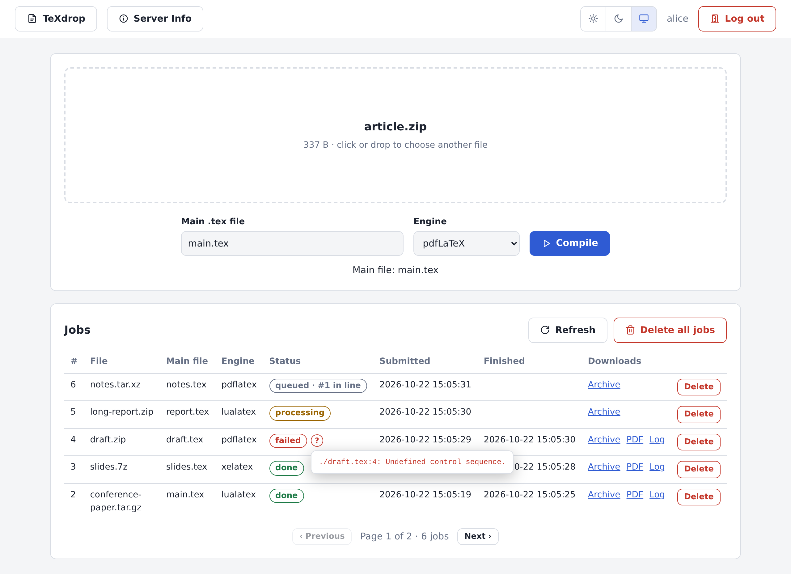

# TeXdrop

Compile LaTeX projects to PDF, for AI agents and for people. Upload a `.zip`, `.7z`, `.tar`,
`.tar.gz`, `.tar.bz2` or `.tar.xz` archive of a project (with its BibTeX/biblatex
bibliography) and get back the PDF and the compilation log.



- **Full TeX Live** (every package, as on Overleaf), compiled with `latexmk` using pdfLaTeX
  (default), XeLaTeX or LuaLaTeX; BibTeX or Biber run automatically. Like Overleaf,
  Ghostscript is there (EPS figures) and Java is not.
- **Main file detection**: the only `.tex` file at the top of the project, or the only one
  there with a `\documentclass`. Otherwise you name it.
- **Queue**: jobs from all users run one at a time, strictly in submission order, while the
  web server stays responsive.
- **Per-user tokens and storage**, a job list with status and queue position, downloads of
  the archive, PDF and log, and deletion of one or all jobs.
- **Sandboxed compilation**: documents cannot read other users' files or the tokens, and
  cannot use the network.
- **A web page** to drop an archive, pick the main file and the engine, and follow the job
  list (point at the **?** of a failed job to see its errors), with the server's settings and
  a light or dark theme.
- **An HTTP API** for programs, and an **MCP server** through which AI agents such as Claude
  Code, Codex and Antigravity compile projects, read the errors and download the PDFs by
  themselves.

Built with **Python, FastAPI and uvicorn** on the TeX Live image. SQLite keeps the job queue.

## Run it

```bash
docker build -t texdrop .                             # about 6 GB: the full TeX Live

docker run -d --name texdrop \
  --restart unless-stopped \
  --cap-drop ALL --security-opt no-new-privileges \
  -p 8000:8000 \
  -e TZ=Europe/Athens \
  -e AUTO_DELETE_DAYS=15 \
  -v texdrop-data:/data \
  texdrop

docker exec texdrop python -m texdrop adduser alice   # prints alice's token
```

Then open `http://your-host:8000` and log in with the token. `--restart unless-stopped`
starts TeXdrop again after a crash or a reboot. Add users the same way, at any time;
`python -m texdrop reset-token alice` gives alice a new token if theirs is lost or leaked.
To let AI agents use TeXdrop, add `-e ENABLE_MCP=1` and connect them as
[MCP.md](docs/MCP.md#connecting-an-agent) shows. For the full sandbox, the host needs
Linux 6.12 or newer.

> Mount the volume at **`/data`**: that is where TeXdrop keeps the users, the jobs and the
> log. To keep them in a directory on the host instead, give it to **UID/GID 61001**, the
> user TeXdrop runs as, first: `sudo chown 61001:61001 /your/dir`. See
> [Deployment](docs/DEPLOYMENT.md#a-directory-on-the-host).

> It also works behind an HTTPS reverse proxy as it is. There, set `PUBLIC_BASE_URL` to the
> address users reach (such as `https://texdrop.example.com`), so that browsers may send
> changes only from pages at that address: see [Reverse proxies](docs/DEPLOYMENT.md#reverse-proxies).

## Documentation

- [Deployment](docs/DEPLOYMENT.md): building, running with or without Docker, the data
  directory, reverse proxies, container limits and logs.
- [Configuration](docs/CONFIGURATION.md): the users, every environment variable, and the
  fixed limits.
- [API](docs/API.md): every endpoint, how jobs behave, and examples in the shell and Python.
- [MCP server](docs/MCP.md): connecting AI agents, the tools and the transfer links.
- [Security](docs/SECURITY.md): the sandbox and the other protections, older kernels, and
  how to report a vulnerability.
- [Development](docs/DEVELOPMENT.md): how it works, the tests, and updating the dependencies.

## License

[MIT](LICENSE)
